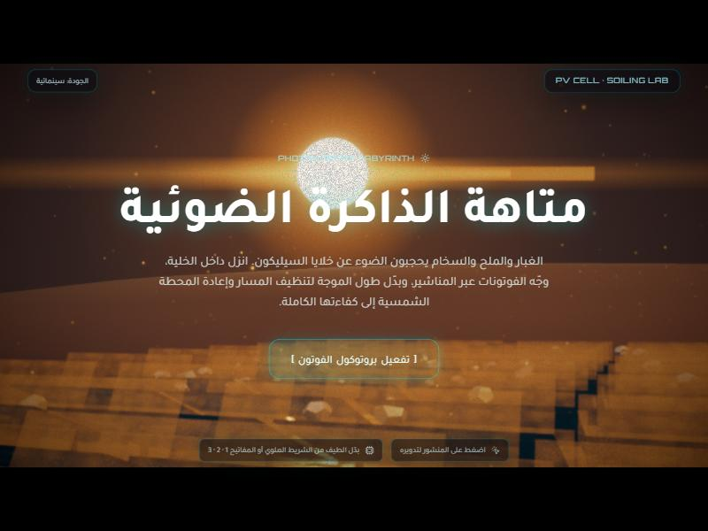
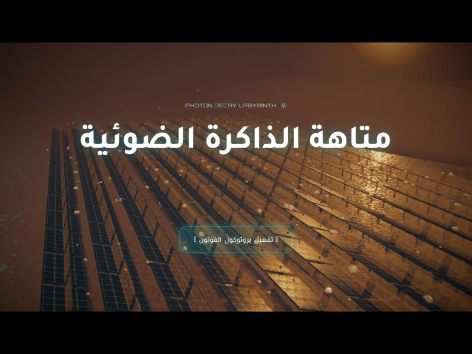
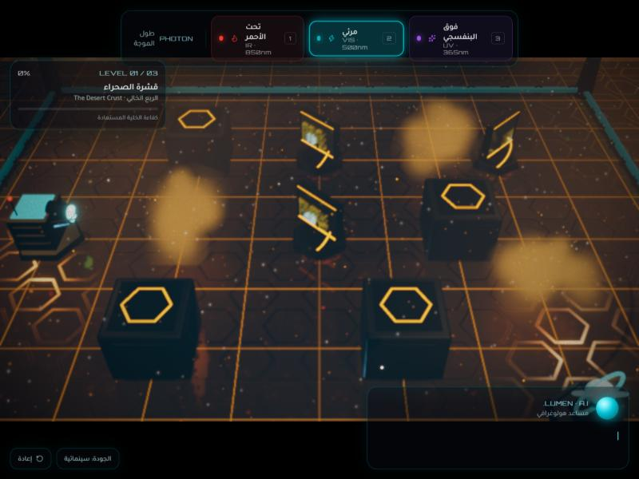
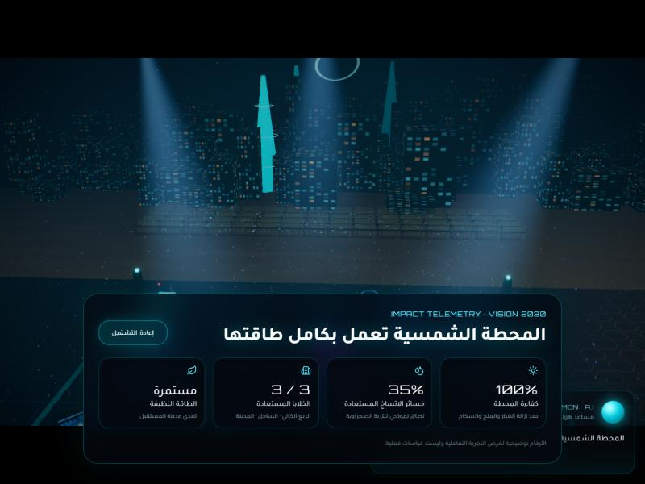

# متاهة الذاكرة الضوئية — Photon Decay Labyrinth

تجربة ويب تفاعلية ثلاثية الأبعاد بالكامل ولعبة ألغاز ضوئية: تنزل داخل خلية سيليكون شمسية متسخة، توجّه شعاع فوتونات عبر مناشير بلورية، وتبدّل طول الموجة لتنظيف المسار حتى تعود المحطة الشمسية إلى كفاءتها الكاملة.

A purely 3D, cinematic WebGL puzzle game built with Three.js + React Three Fiber.

## لقطات

| الافتتاحية | لقطة الرافعة |
|---|---|
|  |  |
| **المستوى الأول** | **الختام** |
|  |  |

## التشغيل

```bash
npm install
npm run dev
```

ثم افتح `http://localhost:5173`.

| أمر | الوظيفة |
|---|---|
| `npm run dev` | خادم التطوير |
| `npm run typecheck` | فحص TypeScript بدون إخراج |
| `npm run build` | بناء الإنتاج في `dist/` |
| `npm run preview` | معاينة بناء الإنتاج |

## طريقة اللعب

- **[ تفعيل بروتوكول الفوتون ]** في الشاشة الافتتاحية يغوص بالكاميرا داخل الخلية.
- **اضغط على أي منشور** لتدويره 90°. المنشور يعكس الشعاع بزاوية قائمة.
- **بدّل طول الموجة** من الشريط العلوي أو بالمفاتيح `1` `2` `3`:
  - تحت الأحمر `#FF3B30`: يبخّر سحب الغبار (يحتاج ~1 ثانية من التعريض).
  - مرئي `#00F0FF`: الوحيد الذي يشحن المستقبِلات ويقفلها.
  - فوق البنفسجي `#A855F7`: يكسر بلورات الملح إلى شظايا.
- **حلقات الطاقة** تغيّر طول موجة الشعاع المار بها، **الدوامات** تثنيه 90° باتجاه عقارب الساعة، **البوابات** لا تمرّر إلا طول موجة واحد، **كرات الكربون** تتحرك كل 1.6 ثانية وتحجب الممر.
- يكتمل المستوى عندما تُقفل كل المستقبِلات. ثلاثة مستويات: الربع الخالي، الساحل البحري، المدينة الصناعية، ثم مشهد الختام.

## البنية

```
src/
  levels/      تعريف الشبكة والعناصر لكل مستوى + ألوان البيئة
  engine/      تتبع الشعاع على الشبكة (trace.ts) وناقل الأحداث
  store/       حالة اللعبة (zustand) + القيم المتغيرة لكل إطار
  three/       المشهد: الكاميرا، المعالجة اللاحقة، الشعاع، العناصر، الجسيمات، المدينة
  ui/          الطبقة الزجاجية: الشريط العلوي، لومن، بطاقات الإكمال والختام
  audio/       مؤثرات صوتية مولّدة بـ WebAudio بدون ملفات
scripts/solve.ts   فاحص قابلية الحل لكل المستويات
docs/              تقارير التصميم والاختبار وجولة الرسوميات (graphics-pass.md)
```

## التقنيات

Vite 8 · React 19 · TypeScript · Tailwind v4 · three r187 · @react-three/fiber 9 · @react-three/drei 10 · @react-three/postprocessing 3 · zustand 5 · lucide-react

## ملاحظات

- الأرقام في بطاقة الأثر الختامية توضيحية وليست قياسات فعلية.
- زر «الجودة» يبدّل بين الوضع السينمائي (أرضية عاكسة، DoF، God Rays، MSAA، جسيمات أكثر) والوضع الخفيف. تنخفض الجودة تلقائيًا إذا بقيت الإطارات منخفضة أثناء اللعب.
- المشروع لا يحمّل أي أصول خارجية ما عدا خطوط Google Fonts (Orbitron وTajawal).
